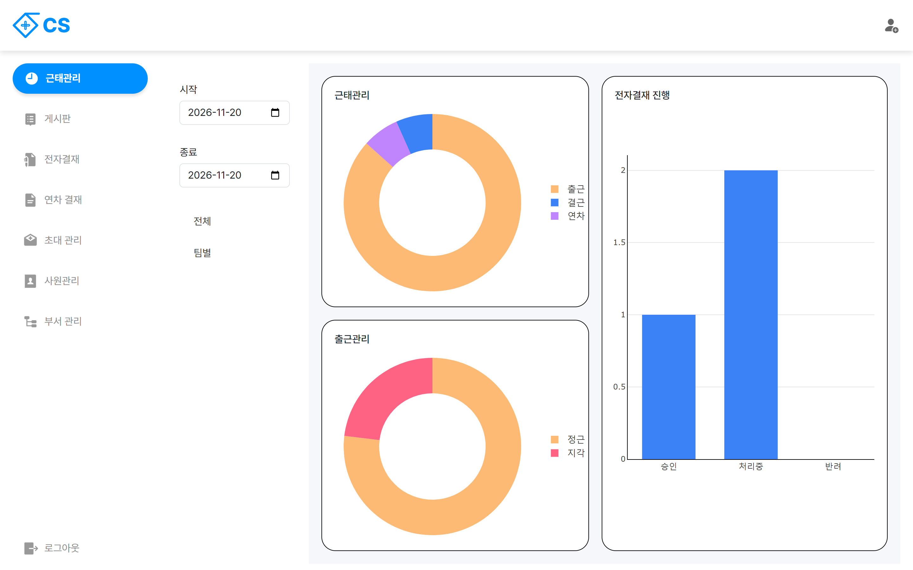
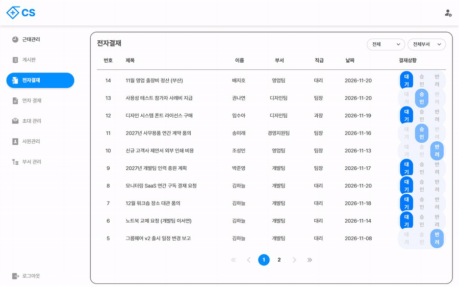
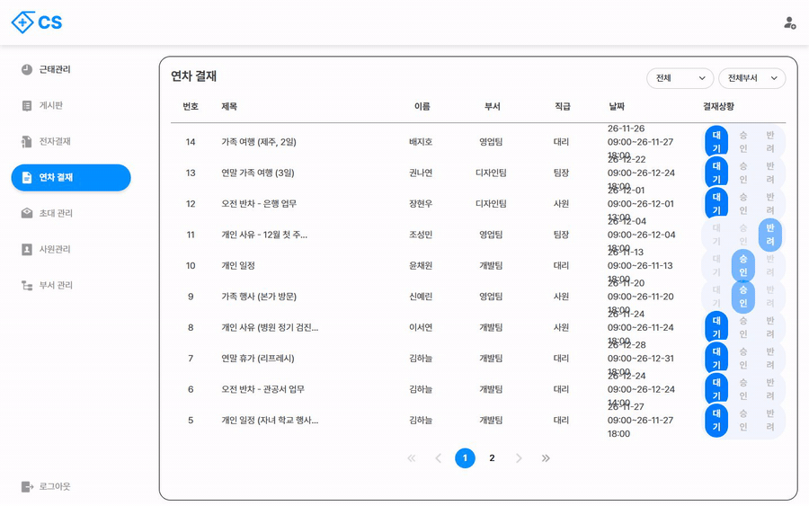
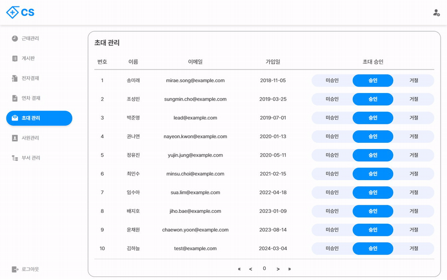
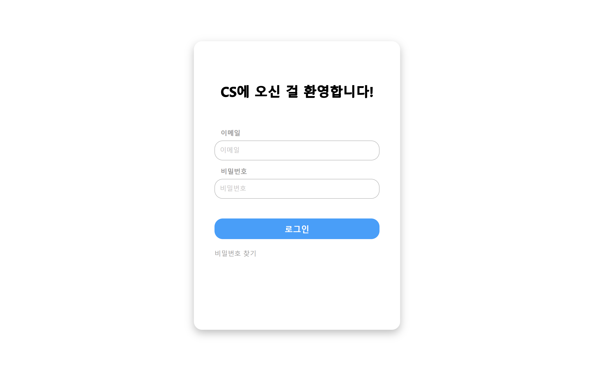
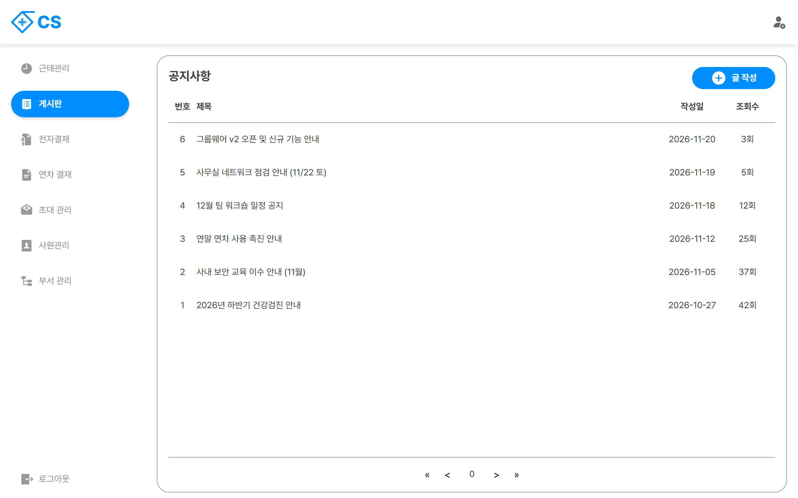
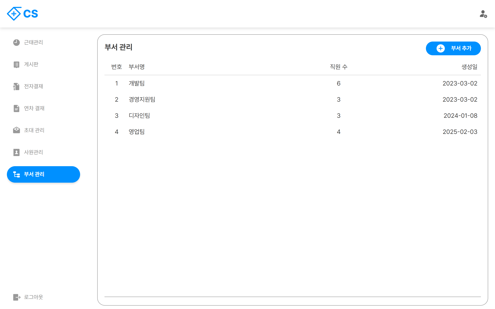
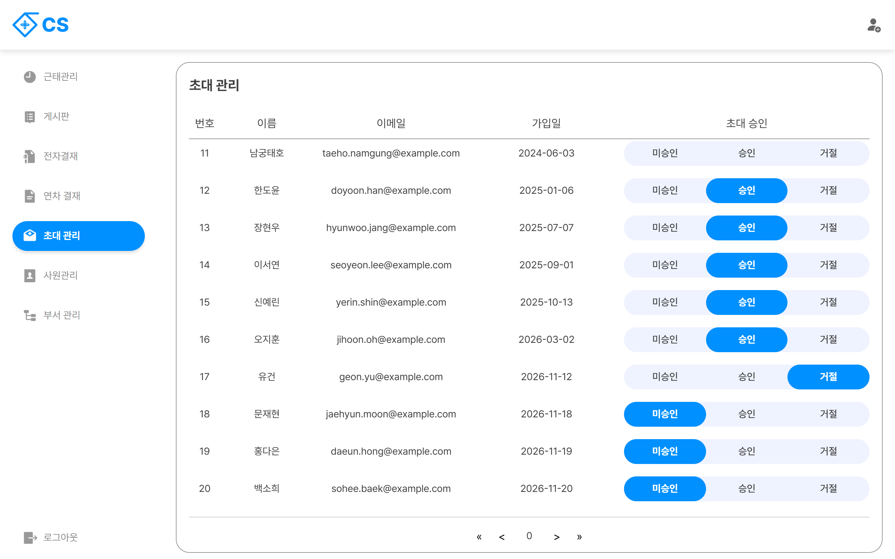

<div align="center">

# 🏢 CS 그룹웨어 — 회사 관리자 웹

**직원 승인부터 결재 · 연차 처리, 근태 현황까지 관리자가 쓰는 화면**

Spring MVC + JSP로 만든 그룹웨어의 관리자용 서버 렌더링 웹



</div>

<br>

## 0. 담당 파트 — 결재 · 연차 승인, 근태 현황, 첨부파일

> 직원용 서비스에서 만든 **전자결재 · 연차 · 근태**의 관리자 쪽을 맡았습니다. 서류 · 연차 신청을 **승인 / 반려**하는 목록과 상세, 연차 승인 시 **잔여 연차 차감과 일정 등록**, 근태 현황 대시보드, 첨부파일 다운로드를 만들었습니다.<br>
> Spring MVC · MyBatis · JSP · jQuery · Oracle · Google Cloud Storage

| 기능 | 한 일 |
| :--- | :--- |
| **전자결재 관리** | 회사 전체 결재 서류 목록(상태 · 부서 필터, 페이지), 상세와 첨부파일, 대기 · 승인 · 반려 상태 변경 |
| **연차 결재** | 연차 신청 목록 · 상세, 승인하면 사용 시간만큼 잔여 연차 차감 + 직원 일정에 휴가 등록, 반려 |
| **근태관리** | 기간 · 팀별 출근 / 결근 / 연차, 정근 / 지각, 결재 진행 현황 차트 |
| **첨부파일** | 결재 첨부파일 다운로드(GCS) |

<br>

## 1. 프로젝트 소개

**CS 그룹웨어**는 회사 단위로 가입해 쓰는 사내 협업 서비스입니다. 직원은 React 화면에서 출퇴근 · 연차 신청 · 전자결재 · 채팅을 하고, **회사 관리자는 이 웹에서** 직원을 승인하고 조직을 꾸리며 결재와 연차를 처리합니다.

| 항목 | 내용 |
| :--- | :--- |
| 기간 | 2025.10.13 ~ 2025.11.10 (약 4주, 그룹웨어 전체) |
| 인원 | 5명 |
| 이 저장소 | 관리자용 — Spring MVC 5.3 + JSP, 세션 로그인 |
| 직원용 | [CS_Boot](https://github.com/jaann20914-eng/CS_Boot)(Spring Boot API) + [CS_React](https://github.com/jaann20914-eng/CS_React) — 직원 화면은 CS_Boot README에 있습니다 |

<br>

---

## 2. 화면 구성

```text
관리자 (세션 로그인 · company_code 로 회사 데이터만)
├── 근태관리      기간 · 전체 / 팀별 출근 · 결근 · 연차, 정근 · 지각, 전자결재 진행 차트      ← 담당
├── 게시판        공지 목록 · 작성 · 수정 · 삭제
├── 전자결재      결재 서류 목록 · 상세 · 첨부파일 · 승인 / 반려                         ← 담당
├── 연차 결재     연차 신청 목록 · 상세 · 승인(잔여 연차 차감 · 일정 등록) / 반려          ← 담당
├── 초대 관리     가입 신청 직원 미승인 / 승인 / 거절
├── 사원관리      부서 · 직급 지정, 직원 / 퇴사 처리
├── 부서 관리     부서 목록 · 인원 · 부서 추가
└── 로그인 · 비밀번호 찾기(이메일 인증)
```

| 메뉴 | 요청 | 처리 |
| :--- | :--- | :--- |
| 근태관리 | `GET /commute?startDate&endDate&type` · `GET /commute/teamList` | 기간 · 팀별 집계 3종을 JSON으로 넘겨 차트로 그림 |
| 전자결재 | `/approval` · `/approval/detail` · `/approval/updatestatus` | 목록 · 상세 · 상태 변경(비동기) |
| 연차 결재 | `/pto` · `/pto/detail` · `/pto/updatestatus` | 승인 시 차감 → 상태 변경 → 일정 등록 |
| 초대 · 사원 | `/invite/list` · `/invite/status` · `/job/list` · `/job/updateDept` · `/job/updateLevel` · `/job/updateStatus` | 가입 승인, 부서 · 직급 · 재직 상태 |
| 부서 · 공지 | `/department/*` · `/notice/*` | 부서 추가 · 삭제, 공지 CRUD |
| 파일 | `/file/download` | 첨부파일 다운로드 |

<br>

---

## 3. 주요 화면

> 화면은 저장소 코드를 로컬에서 실제로 실행해 녹화했습니다. 저장소에 DB 스크립트가 없어 매퍼 SQL에 맞춰 Oracle 호환 모드 내장 DB에 테이블과 예시 데이터(가상의 회사 · 직원)를 넣었고, 파일 저장은 GCS 대신 로컬 폴더, 메일은 보내지 않도록 바꿔 실행했습니다.

### 3.1 전자결재 승인 (담당)



- 회사 전체 결재 서류를 **상태(대기 · 승인 · 반려)와 부서**로 걸러 봅니다.
- 상세에서 본문과 첨부파일을 확인하고 **승인 / 반려**하면, 상태가 바로 바뀌고 직원 화면에도 그대로 반영됩니다.

### 3.2 연차 결재 (담당)



- 직원이 신청한 휴가 기간(종일 · 반차)을 보고 승인하면 **사용 시간만큼 잔여 연차를 줄이고**, 직원 일정(먼슬리)에 휴가를 넣습니다.
- 잔여 연차가 모자라면 승인하지 않고 알려 줍니다.

### 3.3 근태관리 (담당)


- 기간을 고르면 그 사이 **출근 · 결근 · 연차**, **정근 · 지각**, **전자결재 승인 · 처리중 · 반려** 수를 차트로 보여 줍니다.
- 전체 / 팀별을 바꿔 부서마다 볼 수 있고, 조회 기간은 최근 1년 안으로 제한했습니다.

### 3.4 직원 승인과 조직 관리 (팀원 담당)



- 직원이 회사 코드로 가입하면 **초대 관리**에 미승인으로 쌓이고, 관리자가 승인해야 로그인할 수 있습니다.
- **사원관리**에서 부서 · 직급을 고르고 퇴사 처리를 합니다. **부서 관리**에서 부서를 추가합니다.

<details>
<summary>그 밖의 화면 (로그인 · 게시판 · 부서 관리 · 목록)</summary>
<br>

 
 

</details>

<br>

---

## 4. 구현 포인트 (담당 코드)

### 4.1 연차 승인은 "차감 → 상태 → 일정" 순서로

```text
/pto/updatestatus (newStatus = y)
  1. 잔여 연차에서 사용 시간 차감    실패하면 "lack" 반환 → 승인 안 함
  2. 신청 상태를 승인으로 변경
  3. 직원 일정에 휴가 등록          실패해도 승인은 유지 (로그만 남김)
(newStatus = n) → 상태만 반려로 변경
```

- 잔여가 모자라 차감이 안 되면 상태를 바꾸지 않아, 연차가 음수가 되는 승인을 막습니다. (`pto_request/Pto_requestService.java` `processStatusUpdate`)

### 4.2 목록에서 바로 승인 · 반려

- 목록의 각 행에 대기 · 승인 · 반려 버튼을 두고, 누르면 번호와 새 상태만 `updatestatus`로 보내(AJAX) 바꿉니다. 상세 화면에 들어가지 않고도 여러 건을 빠르게 처리할 수 있습니다.

### 4.3 회사별 데이터 분리

- 로그인하면 세션에 `company_code`를 넣고, 결재 · 연차 · 근태 조회가 모두 이 값으로 자기 회사 데이터만 가져옵니다.

<br>

---

## 5. 기술 스택

| 분류 | 기술 |
| :--- | :--- |
| **Backend** | Java 11, Spring MVC 5.3, MyBatis 3.5 + mybatis-spring, Commons DBCP2, Gson |
| **View** | JSP · JSTL, jQuery, Plotly.js(근태 차트) |
| **Database** | Oracle Database (ojdbc8) |
| **Storage · Mail** | Google Cloud Storage, Jakarta Mail(Naver SMTP) |
| **Server** | Apache Tomcat (WAR) |

<br>

---

## 6. 팀원

| 이름 | 담당 (관리자 웹) |
| :-: | :--- |
| [박지원](https://github.com/jaann20914-eng) | 전자결재 · 연차 결재 관리, 근태관리 대시보드, 첨부파일 |
| [dayun-50](https://github.com/dayun-50) | 관리자 로그인 · 비밀번호 찾기 · 이메일 인증, 회사 정보 |
| [장영서](https://github.com/jangyeongseo) | 공지 게시판, 초대 관리, 사원관리(부서 · 직급), 부서 관리, 근태관리 |
| [Fuigang](https://github.com/Fuigang) · [tmd0487](https://github.com/tmd0487) | 직원용 서비스 (메일, 화면 UI) |

> 이 저장소는 팀 원본 저장소를 fork한 것입니다. 코드는 그대로 두고 README만 정리했습니다. 녹화한 실행본에서는 사원관리의 직급 변경에 필요한 스크립트 함수(`updateLevel`)가 빠져 있어 로컬 사본에만 추가했습니다.
