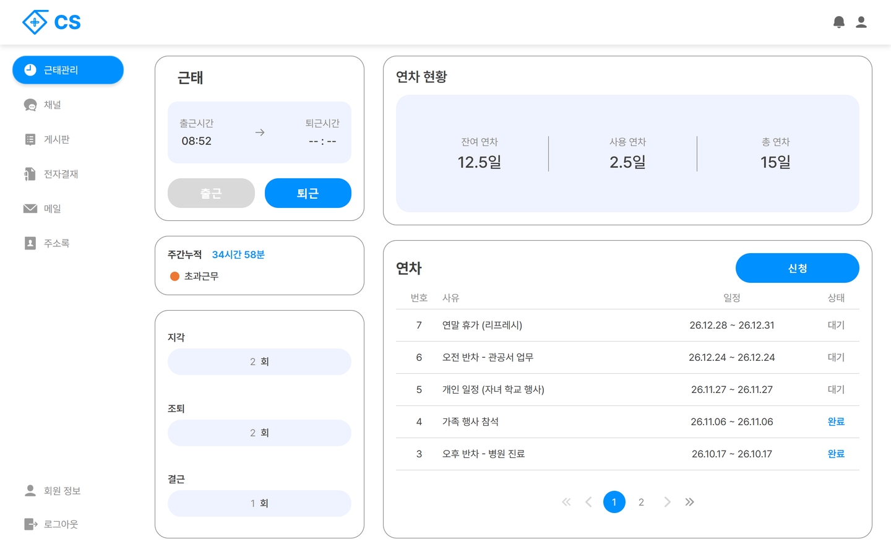
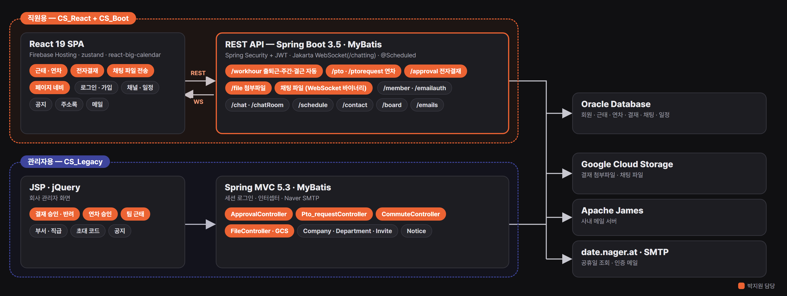
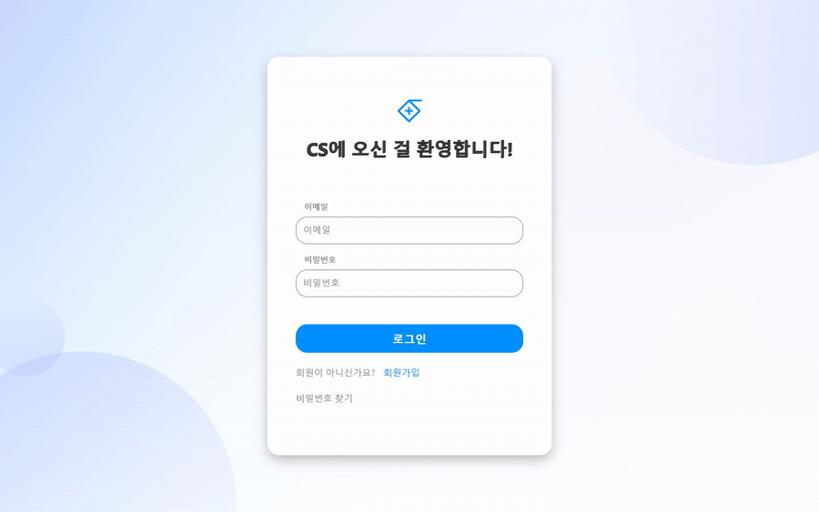
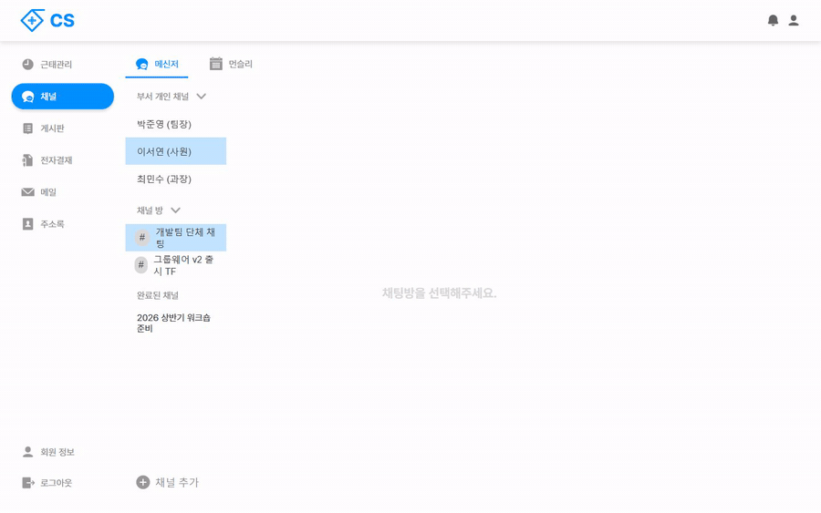

<div align="center">

# 🏢 CS 그룹웨어 — 사내 업무 협업 서비스

**출퇴근부터 결재, 팀 채팅까지 한 곳에서**

근태 · 연차 관리, 전자결재, 채널 메신저 · 일정, 공지, 주소록, 사내 메일을 묶은 그룹웨어<br>
직원용 React + Spring Boot와 관리자용 Spring MVC(JSP)로 나눠 만든 팀 프로젝트



</div>

<br>

## 0. 담당 파트 — 근태 · 연차, 전자결재, 파일 (프론트 + 백엔드 + 관리자)

> 직원이 매일 쓰는 **근태관리 · 연차**와 **전자결재**를 React 화면, Spring Boot API, 관리자 JSP 화면까지 맡았습니다. 첨부파일 모듈과 **채팅 파일 전송**, 공통 페이지 네비게이션, React 프로젝트 세팅 · Firebase 배포와 PR 병합도 담당했습니다.<br>
> React · Spring Boot · Spring MVC · MyBatis · Oracle · Google Cloud Storage · WebSocket

| 기능 | 한 일 |
| :--- | :--- |
| **출퇴근** | 출근 · 퇴근 기록, 9시 이후 출근은 지각 · 18시 전 퇴근은 조퇴 판정, 주간 누적 근무 시간 |
| **결근 자동 처리** | 매일 23:59 스케줄러가 주말 · 공휴일을 빼고, 연차자를 제외한 미출근자를 결근으로 일괄 저장 |
| **연차** | 잔여 · 사용 · 총 연차, 연차 신청(종일 · 오전 반차 · 오후 반차, 여러 날), 신청 내역과 상태 |
| **연차 자동 부여** | 입사 기념일마다 연차 지급(1년 미만 11일, 이후 15일 + 2년마다 1일, 최대 25일), 중복 지급 방지 |
| **전자결재** | 서류 작성(제목 · 본문 · 첨부파일), 전체 · 처리중 · 반려 · 완료 목록, 상세 · 수정 · 삭제 |
| **관리자 화면 (JSP)** | 결재 승인 · 반려, 연차 승인, 팀 근태 조회 |
| **파일** | 첨부파일 업로드 · 다운로드 · 교체 모듈(GCS), 채팅방 파일 전송(WebSocket 바이너리) |
| **공통 · 협업** | 페이지 네비게이션 컴포넌트, React 프로젝트 세팅, Firebase Hosting 배포, 팀 PR 병합 |

<br>

## 1. 프로젝트 소개

**CS 그룹웨어**는 회사 단위로 가입해 쓰는 사내 협업 서비스입니다.

- 회사 관리자가 부서 · 직급과 **초대 코드**를 만들고, 직원은 가입 후 승인을 받아 들어옵니다.
- 직원은 **출퇴근을 찍고 연차를 신청**하며, **전자결재**로 서류를 올립니다. 결재 승인과 연차 승인은 관리자 화면에서 합니다.
- **채널 메신저**(1:1 · 단체 · 파일 전송)와 **일정**, 공지, 주소록, 사내 메일로 소통합니다.

| 항목 | 내용 |
| :--- | :--- |
| 기간 | 2025.10.13 ~ 2025.11.10 (약 4주) |
| 인원 | 5명 |
| 형태 | 팀 웹 프로젝트 — 직원용 SPA + REST API, 관리자용 JSP |

| 저장소 | 내용 |
| :--- | :--- |
| [CS_React](https://github.com/jaann20914-eng/CS_React) | 직원용 화면 (React) |
| [CS_Boot](https://github.com/jaann20914-eng/CS_Boot) | 직원용 API (Spring Boot) |
| [CS_Legacy](https://github.com/jaann20914-eng/CS_Legacy) | 관리자용 화면 · 서버 (Spring MVC + JSP) |

<br>

---

## 2. 서비스 구성



```text
직원용 (CS_React + CS_Boot)
├── 근태관리      출근 · 퇴근 · 주간 누적 · 지각 / 조퇴 / 결근 · 연차 현황 · 연차 신청      ← 담당
├── 전자결재      서류 작성 · 첨부 · 처리중 / 반려 / 완료 목록 · 상세                   ← 담당
├── 채널          1:1 · 부서 · 프로젝트 채팅방 · 파일 전송(담당) · 먼슬리 일정
├── 게시판        공지사항
├── 메일          사내 메일 (Apache James)
├── 주소록        개인 · 팀 주소록
└── 회원          가입 · 로그인 · 비밀번호 찾기 · 회원 정보

관리자용 (CS_Legacy)
├── 회사 · 부서 · 직급 · 초대 코드 · 직원 승인
├── 결재 승인 · 반려, 연차 승인, 팀 근태                                              ← 담당
└── 공지 작성
```

<br>

---

## 3. 주요 기능

> 화면은 저장소 코드를 로컬에서 실제로 실행해 녹화했습니다. 저장소에 DB 스크립트가 없어 MyBatis 매퍼에 맞춰 Oracle 호환 모드 내장 DB에 테이블을 만들고 예시 데이터(가상의 회사 · 직원)를 넣었습니다. 파일 저장은 GCS 대신 로컬 폴더로 바꿨고, 메일 서버는 연결하지 않았습니다.

### 3.1 근태관리 · 연차 (담당)



- 로그인하면 첫 화면이 근태관리입니다. **출근**을 누르면 시간이 찍히고, 9시가 지났으면 **지각**으로 셉니다. 위 GIF는 10시 6분에 출근해 지각이 2회 → 3회로 바뀌는 장면입니다.
- 이번 주 **누적 근무 시간**과 이번 달 지각 · 조퇴 · 결근 횟수를 보여 줍니다.
- 오른쪽에서 **잔여 · 사용 · 총 연차**를 보고 바로 **연차를 신청**합니다. 시작 / 종료 시각(09 · 14 · 18시)으로 종일 · 오전 반차 · 오후 반차를 고르고, 신청은 1주 뒤부터 1년 안까지만 됩니다.
- 신청 내역은 대기 · 완료 상태로 쌓이고, 관리자 화면(CS_Legacy)에서 승인합니다.

### 3.2 전자결재 (담당)


- **서류 작성**에서 제목 · 본문을 쓰고 파일을 여러 개 첨부합니다.
- 목록은 **전체 · 처리중 · 반려 · 완료**로 나눠 보고, 상세에서 첨부파일을 내려받습니다.
- 처리중인 서류는 작성자가 수정 · 삭제하고, 승인 · 반려는 관리자 화면에서 합니다.

### 3.3 채팅방 파일 전송 (담당)



- 채팅 입력창에서 파일을 골라 메시지와 함께 보내면, 같은 방 사람들에게 바로 파일 메시지가 보이고 오른쪽 **파일 목록**에 쌓입니다.
- 채팅방 · 메시지 · 일정 등 채널 기능의 나머지는 팀원이 만들었습니다.

### 3.4 그 밖의 기능 (팀원 담당)

- 회원가입 · 로그인(JWT) · 이메일 인증 · 비밀번호 찾기, 회원 정보
- 채널 메신저(채팅방 · 1:1 · 완료된 채널)와 먼슬리 일정
- 공지 게시판, 개인 · 팀 주소록, Apache James 기반 사내 메일
- 관리자 회사 · 부서 · 직급 · 초대 코드 관리

<br>

---

## 4. 구현 포인트 (담당 코드)

### 4.1 결근은 스케줄러가 밤마다 처리

```text
매일 23:59 (CommuteScheduler)
  ├─ 토 · 일이면 종료
  ├─ 공휴일이면 종료  ← date.nager.at 공휴일 API (HolidayService)
  └─ 전체 직원 − 오늘 출근 기록 있는 직원 − 오늘 연차인 직원 = 결근자 → 한 번에 저장
```

- 지각 · 조퇴 판정: 출근 09:00 초과면 지각, 퇴근 18:00 이전이면 조퇴 (`members/commute/CommuteService.java`)
- 공휴일 API가 응답하지 않아도 스케줄러가 멈추지 않도록 처리했습니다.

### 4.2 연차 자동 부여와 반차 계산

- 매일 0시에 입사 기념일이 된 직원에게 연차를 지급합니다. 1년 미만 11일, 그 뒤로 `15 + (근속연수 − 1) / 2`일, 최대 25일입니다. 마지막 지급일(`last_granted_at`)을 확인해 같은 해에 두 번 지급하지 않습니다. (`members/member_pto/Member_ptoService.java`)
- 신청 기간이 여러 날이어도 시작 · 종료 시각(09 · 14 · 18시)을 보고 종일 / 오전 반차 / 오후 반차를 나눠 사용 시간을 계산합니다. (`pto_request/Pto_requestService.java`)

### 4.3 결재 서류와 첨부파일을 한 단위로

- `ApprovalFacadeService`(`@Transactional`)에서 서류 저장과 파일 업로드를 함께 처리합니다. 업로드가 중간에 실패하면 **이미 올라간 GCS 파일을 지워** 서류 없이 파일만 남지 않게 했습니다.
- 수정할 때는 화면에서 **남길 파일 목록**을 받아, 빠진 파일만 지우고 새 파일을 더합니다.
- 파일 모듈(`file/FileService.java`)은 UUID 이름으로 저장하고, 결재 · 채팅이 같은 모듈을 씁니다.

### 4.4 WebSocket으로 파일 보내기

```text
클라이언트 ─▶ JSON {type: "file", 파일 이름}      서버: 세션에 "다음 바이너리 = 이 파일" 임시 저장
클라이언트 ─▶ ArrayBuffer (파일 내용)             서버: 바이트를 MultipartFile로 감싸 GCS + DB 저장
                                                 └▶ 같은 방 접속자 전원에게 파일 메시지 방송
```

- 텍스트 메시지와 같은 연결(`@ServerEndpoint("/chatting")`)로 보내고, 서버는 문자열 메시지와 바이너리 메시지를 다른 `@OnMessage`로 받습니다. (`chatting/endpoint/ChatEndpoint.java`, 화면 `useChatBox.js`)
- 지난 대화를 불러올 때 파일 메시지에는 파일 정보를 합쳐 내려줘 바로 다운로드 링크로 보입니다.

<br>

---

## 5. 기술 스택

| 분류 | 기술 |
| :--- | :--- |
| **Frontend (직원용)** | React 19.2, React Router 7, zustand 5, axios, react-big-calendar, dayjs |
| **Backend (직원용)** | Java 21, Spring Boot 3.5, Spring Security + JWT(java-jwt), MyBatis 3, Jakarta WebSocket, Spring Mail, `@Scheduled` |
| **Backend (관리자용)** | Java 11, Spring MVC 5.3, MyBatis 3.5, JSP · JSTL, jQuery, DBCP2 |
| **Database** | Oracle Database |
| **Storage · 외부** | Google Cloud Storage, Apache James(메일), date.nager.at(공휴일) |
| **배포** | Firebase Hosting(직원용 화면) |

<br>

---

## 6. 팀원

| 이름 | 담당 |
| :-: | :--- |
| [박지원](https://github.com/jaann20914-eng) | 근태 · 연차, 전자결재, 관리자 결재 · 연차 · 근태 화면, 파일 모듈 · 채팅 파일 전송, 페이지 네비, React 세팅 · Firebase 배포 · PR 병합 |
| [dayun-50](https://github.com/dayun-50) | 회원가입 · 로그인 · 비밀번호 찾기 · JWT 보안, 채팅방 · WebSocket 엔드포인트, 일정, 회원 정보, 관리자 로그인 |
| [장영서](https://github.com/jangyeongseo) | 주소록, 공지 게시판, 관리자 부서 · 초대 · 직급 · 직원 관리 |
| [Fuigang](https://github.com/Fuigang) | 사내 메일(Apache James 연동) |
| [tmd0487](https://github.com/tmd0487) | 메신저 · 주소록 · 가입 · 메일 화면 UI |

> CS_Legacy · CS_Boot는 팀 원본 저장소를 fork한 것입니다. 코드는 그대로 두고 README만 정리했습니다.
